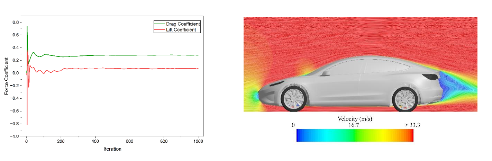
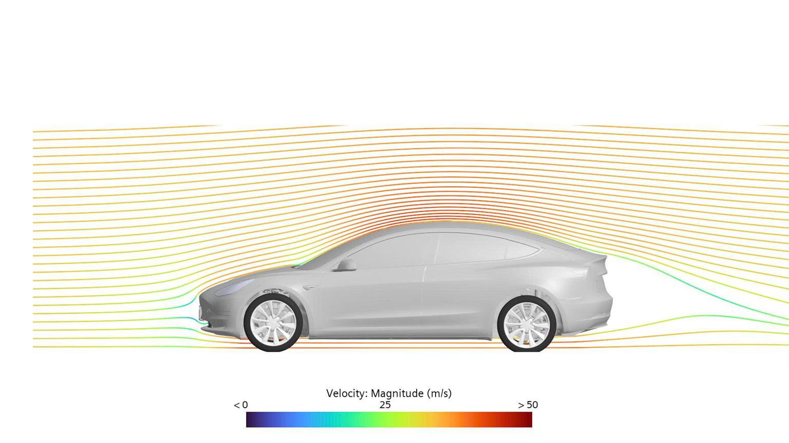
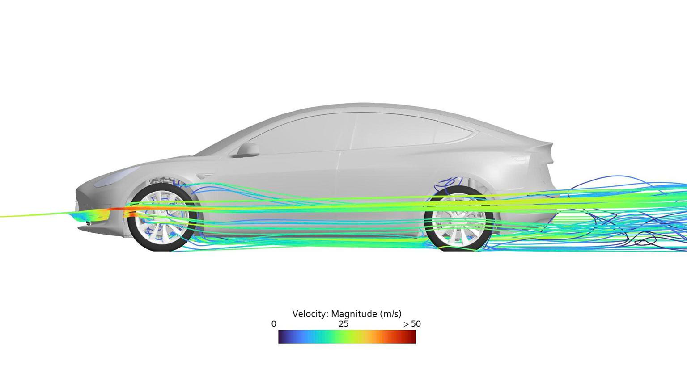
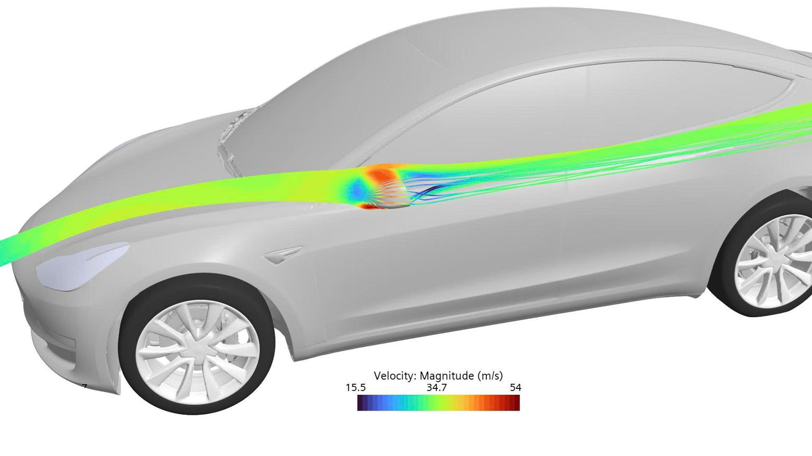

# External Aerodynamics | Vectenor Engineering

## Tesla Model 3 CFD study

A full-vehicle external aerodynamics workflow at 120 km/h, covering geometry preparation, cabin and gap sealing, surface wrapping, local volume refinement, steady-state simulation, wheel-region moving reference frames, and flow-field post-processing.

The study used Simcenter STAR-CCM+. The selected results illustrate flow around the body, front air ducts, and mirrors.

### Force-coefficient history

Drag and lift coefficient histories approach a plateau over approximately 1,000 iterations. The accompanying velocity view highlights acceleration over the body and the low-velocity wake. This figure illustrates force monitoring and flow-field interpretation; it does not establish mesh independence or agreement with physical testing.

### Body flow

### Front air-duct flow

### Mirror flow

The figures are selected simulation visualizations from the team's supplied study. They communicate the modeled flow field. Quantitative drag accuracy and design improvements require convergence and reference-validation evidence.

Our CFD service scope includes STAR-CCM+ and OpenFOAM. The example on this page was performed in STAR-CCM+.

[Vectenor Engineering](https://github.com/vectenor-engineering)
